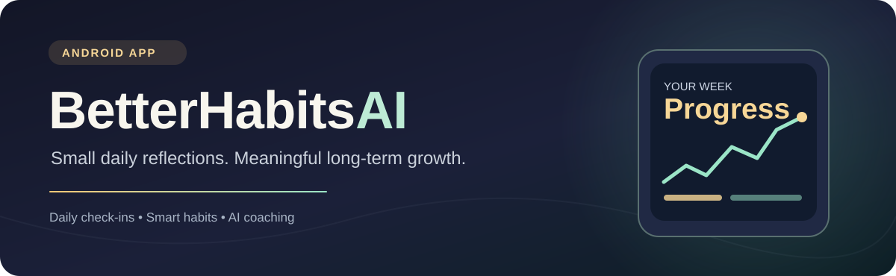
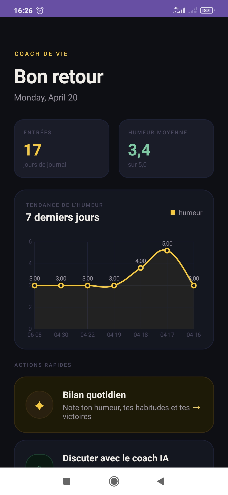
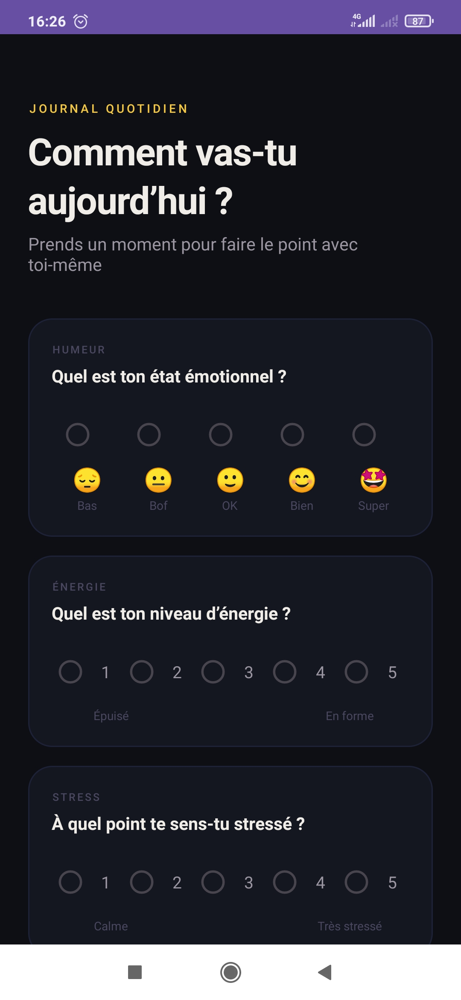
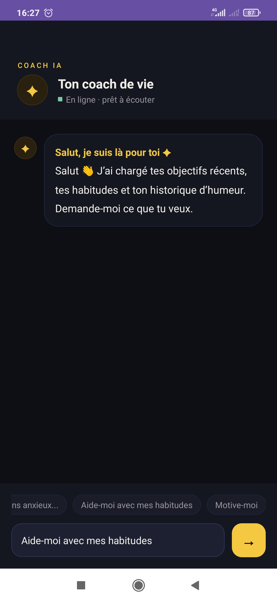
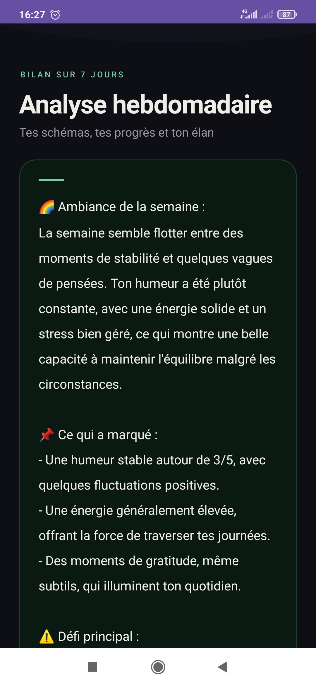

<div align="center">



### Your goals. Your rhythm. A little better every day.

**A native Android productivity and self-reflection app with habit tracking, daily check-ins, and AI-assisted coaching.**

[](https://www.java.com/)
[](https://developer.android.com/)
[](https://developer.android.com/training/data-storage/room)
[](#project-status)

[Explore features](#-what-you-can-do) · [See app screens](#-app-screens) · [Run locally](#-getting-started) · [Add screenshots](docs/screenshots/README.md)

</div>

---

## ✨ Meet BetterHabitsAI

BetterHabitsAI helps you turn scattered intentions into achievable habits. Set goals, reflect on your mood and energy, log everyday wins, and follow your progress over time—through a warm, French-language Android experience.

The app is built with **Java and Android XML**, persists data locally with **Room**, and includes user interfaces and prompt-building logic for **personalized AI coaching**.

> **Development note:** The AI service is intentionally *not connected* in this public repository. The original project included a credential in the Android source; the credential has been removed. AI features require a secure backend. Local habits, journals, and charts are still available. [Learn why →](#-ai-integration--security)

## 🚀 What you can do

| | Feature | Experience |
|:--:|---|---|
| 🎯 | **Goals & habits** | Choose suggested goals and habits or create your own. |
| 🌤️ | **Daily check-ins** | Track mood, energy and stress; capture wins, challenges, gratitude and tomorrow's focus. |
| ✅ | **Habit completion** | Mark habits completed during daily reflections. |
| 📈 | **Progress dashboard** | Visualize recent mood trends, average mood and journal activity. |
| 💬 | **Context-aware AI coach** | Coaching prompts can incorporate saved goals, habits, and journal context. *Requires backend.* |
| ✨ | **Daily AI insights** | Generate supportive next steps from a completed check-in. *Requires backend.* |
| 🗓️ | **Weekly AI reports** | Reflect on the latest seven journal entries. *Requires backend.* |
| 🔒 | **Local-first storage** | Store check-in data using Room on the Android device. |

## 📱 App screens

A look inside the real Android application — from tracking daily mood to getting context-aware coaching and reflecting on your week. Click any screenshot to view it at full resolution.

<table align="center">
  <tr>
    <td align="center" width="25%"><a href="docs/screenshots/01-dashboard.jpg"></a><br /><b>📊 Dashboard</b><br /><sub>Progress at a glance</sub></td>
    <td align="center" width="25%"><a href="docs/screenshots/02-daily-check-in.jpg"></a><br /><b>🌤️ Daily Check-in</b><br /><sub>Track how you feel</sub></td>
    <td align="center" width="25%"><a href="docs/screenshots/03-ai-coach.jpg"></a><br /><b>💬 AI Coach</b><br /><sub>Personalized support*</sub></td>
    <td align="center" width="25%"><a href="docs/screenshots/04-weekly-report.jpg"></a><br /><b>📅 Weekly Report</b><br /><sub>Reflect on your week*</sub></td>
  </tr>
</table>

<sub>*The screenshots show a previously configured AI service. In the public GitHub code, AI requests require connecting your own secure backend. Some screenshots retain the original French **Coach de Vie** branding from before the project was renamed to **BetterHabitsAI**.</sub>

**📸 Adding more screenshots:** See the [screenshot guide](docs/screenshots/README.md). To add images on GitHub, use [Upload files → `docs/screenshots/`](https://github.com/namerami/BetterHabitsAI/upload/main/docs/screenshots) after creating the repository.

## 🛠️ Technology stack

| Layer | Tools |
|---|---|
| Native application | Java 11, Android SDK 36 (minimum API 24) |
| UI | Android XML layouts, AppCompat, Material Components |
| Persistence | Room 2.8.4 / SQLite |
| Networking | OkHttp 4.12.0 and JSON |
| Data visualization | MPAndroidChart 3.1.0 |
| Build | Android Gradle Plugin 9.0.1 · Gradle Kotlin DSL |
| AI | Chat-completions-compatible request/response interface (backend not included) |

## 🧱 Project structure

```text
BetterHabitsAI/
├── app/
│   ├── src/main/
│   │   ├── java/com/yourpackage/coachdevie/
│   │   │   ├── LauncherActivity.java        # Launch flow and demo data
│   │   │   ├── MainActivity.java            # Goals and habit setup
│   │   │   ├── HomeActivity.java            # Dashboard + mood chart
│   │   │   ├── CheckInActivity.java         # Daily journal
│   │   │   ├── ResultActivity.java          # Daily AI feedback screen
│   │   │   ├── ChatActivity.java            # AI coaching screen
│   │   │   ├── WeeklyReportActivity.java    # Weekly insights screen
│   │   │   ├── data/                        # Room entities, DAO, repository
│   │   │   └── network/ApiClient.java      # Sanitized AI backend client
│   │   └── res/                            # UI, strings, themes, icons
│   └── build.gradle.kts
├── docs/
│   ├── assets/                             # README cover image
│   └── screenshots/                        # Four real app screenshots + guide
├── gradle/                                 # Wrapper + dependency versions
├── SECURITY.md
├── README.md
├── settings.gradle.kts
└── gradlew / gradlew.bat
```

> **Naming note:** The user-facing launcher label, in-app header and Android Studio project are **BetterHabitsAI**. The existing Java package / `applicationId` (`com.yourpackage.coachdevie`) is intentionally unchanged so existing installs aren't unexpectedly treated as a different app. Choose a unique package ID before Play Store publication.

## ▶️ Getting started

1. Install [Android Studio](https://developer.android.com/studio) with the Android SDK for **API 36**.
2. Clone this repository (or download its ZIP), then open the project directory in Android Studio.
3. Let Gradle sync, and download any missing SDK packages when prompted.
4. Use an emulator or Android device running **Android 7.0 / API 24** or newer.
5. Click **Run ▶** on the `app` configuration.

**From the command line:**

```bash
# Windows
.\gradlew.bat assembleDebug

# macOS / Linux
./gradlew assembleDebug
```

The app starts with demonstration content if there are no saved journal entries. This is intended for showcasing charts and reports and does **not** represent real user activity.

## 🤖 AI integration & security

The original Android project called an AI provider directly and included a provider credential. **The credential has been removed in this GitHub copy**, and direct provider authentication has been removed from the mobile client.

The sanitized `app/src/main/java/com/yourpackage/coachdevie/network/ApiClient.java` has an empty `HTTPS_BACKEND_URL`. Until you supply a **working HTTPS endpoint you control**, AI chat, daily feedback, and weekly reports will display configuration errors.

To complete the integration securely:

1. Build or deploy an **authenticated server-side API** that accepts the same JSON chat-completion payload and returns `{ "choices": [{ "message": { "content": "..." } }] }`.
2. Store the AI provider key **only on that backend**; apply authentication, authorization, rate limiting and spending caps.
3. Put the backend's public `https://...` endpoint (not a secret) into `HTTPS_BACKEND_URL` in `ApiClient.java`.
4. Add appropriate user consent and privacy disclosures before transmitting personal journal data to the service.

**Never store a real provider key in an APK**, including `BuildConfig`, `local.properties`, Java strings or XML resources. If you own the key from the original project, **revoke/rotate it** before publication. Read the [security and privacy notes](SECURITY.md).

## 🧭 Roadmap

- [x] Goals and habits setup
- [x] Local daily journal and habit completion
- [x] Dashboard with mood chart
- [x] AI coach, daily insights and weekly report UI
- [ ] Authenticated secure AI backend
- [ ] Privacy/consent onboarding and personal data controls
- [ ] Opt-in demo data
- [ ] Database migration tests and expanded UI tests
- [x] Add four real app screenshots
- [ ] Add more screens and a short demo video

## 📌 Project status

**Portfolio prototype · work in progress.** Built to explore native Android development, local persistence, productivity design and AI-enhanced self-reflection. The current product experience is primarily **in French**.

---

<div align="center">

**Made with care and a commitment to better habits.** ✨

[GitHub @namerami](https://github.com/namerami) · [Screenshots](docs/screenshots/README.md) · [Security](SECURITY.md)

</div>
